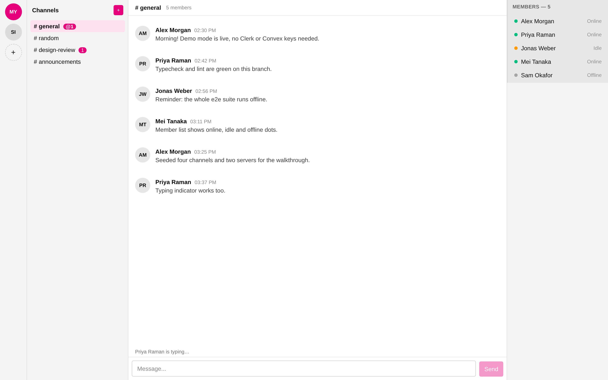
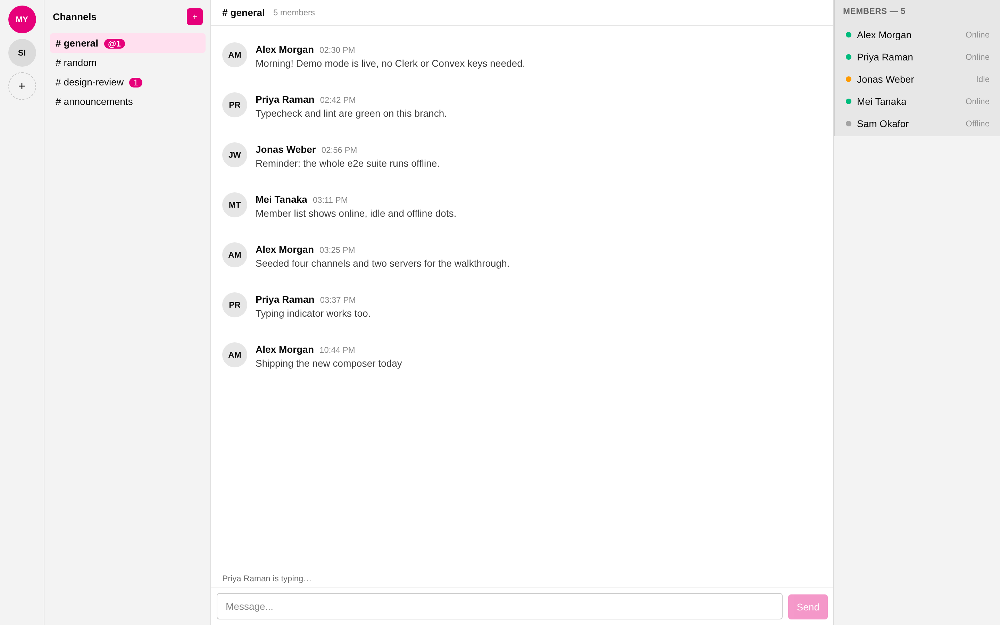
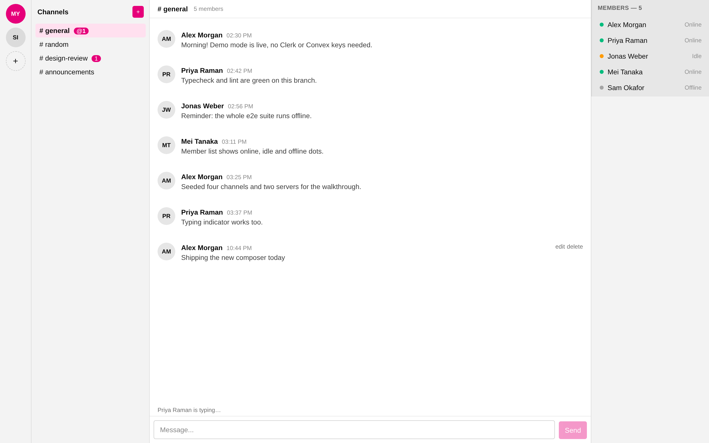
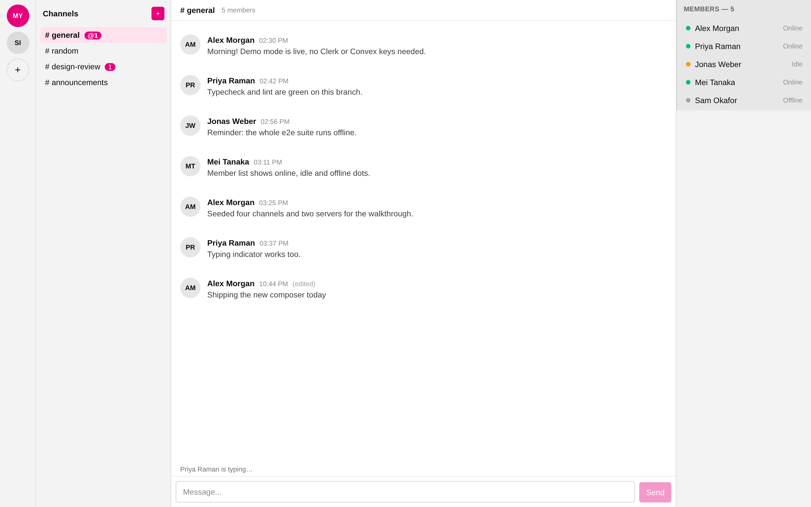
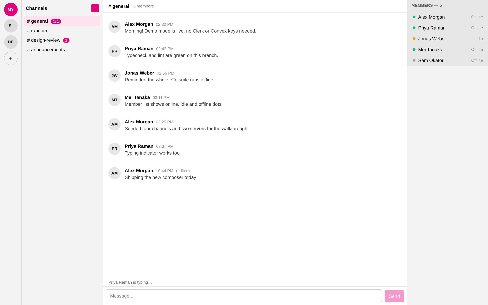
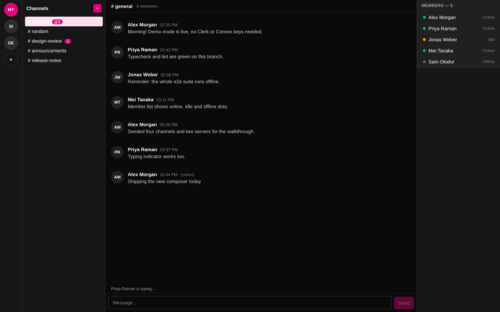
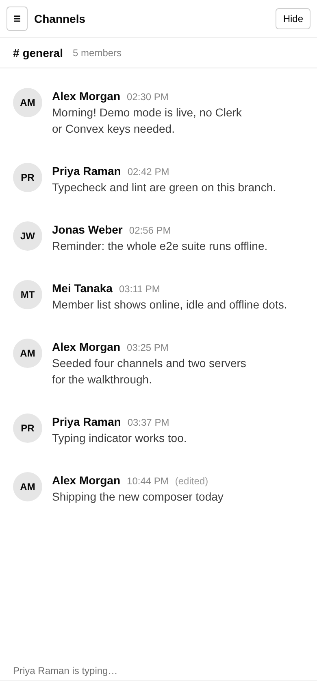
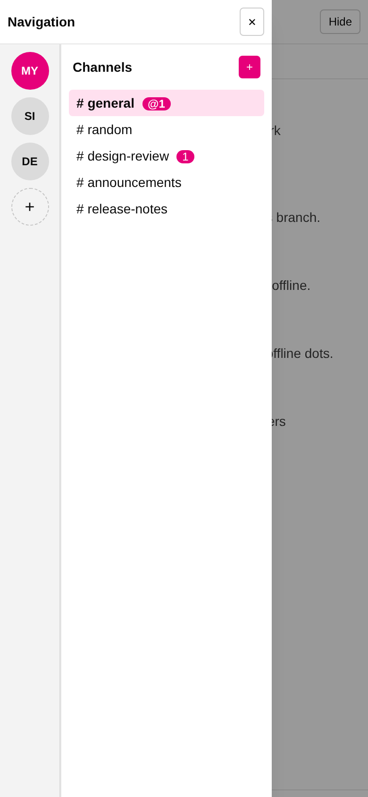

# Mylord

Discord clone ("Magenta"), built as a Turborepo monorepo.

## Screenshots



| What it shows | File | |
| --- | --- | --- |
| Channel list, seeded history, member panel | [`01-chat.png`](docs/media/01-chat.png) |  |
| Sending a message | [`03-message-sent.png`](docs/media/03-message-sent.png) |  |
| Hover actions on your own message | [`04-hover-actions.png`](docs/media/04-hover-actions.png) |  |
| Editing a message, with the `(edited)` marker | [`06-edited.png`](docs/media/06-edited.png) |  |
| Creating a server | [`08-server-created.png`](docs/media/08-server-created.png) |  |
| Dark mode | [`12-dark-mode.png`](docs/media/12-dark-mode.png) |  |
| Mobile layout | [`13-mobile.png`](docs/media/13-mobile.png) |  |
| Mobile navigation drawer | [`14-mobile-drawer.png`](docs/media/14-mobile-drawer.png) |  |

More stills: [`02-typing.png`](docs/media/02-typing.png) ·
[`05-editing.png`](docs/media/05-editing.png) ·
[`07-create-server.png`](docs/media/07-create-server.png) ·
[`09-create-channel.png`](docs/media/09-create-channel.png) ·
[`10-channel-created.png`](docs/media/10-channel-created.png) ·
[`11-channel-switched.png`](docs/media/11-channel-switched.png)

## Demo


[Download the walkthrough (MP4)](docs/media/walkthrough.mp4)

A real browser session against the app: it sends a message, edits it, creates a server and a
channel, switches channels, flips to dark mode, and opens the mobile navigation drawer.

## Demo mode

`DEMO_MODE=1` (and `NEXT_PUBLIC_DEMO_MODE=1` for client code) runs the app against an in-memory
seed instead of Clerk + Convex, so it can be run and captured with no credentials at all.

```sh
bun install
cd apps/web
DEMO_MODE=1 NEXT_PUBLIC_DEMO_MODE=1 bun run dev
```

To regenerate the media in this README, capture against a production server — `next dev` paints
the Next.js dev indicator into every frame:

```sh
cd apps/web
DEMO_MODE=1 NEXT_PUBLIC_DEMO_MODE=1 bun run build
DEMO_MODE=1 NEXT_PUBLIC_DEMO_MODE=1 bun run start --port 3000
# in a second shell
cd apps/web
bun run capture:media
```

`ffmpeg` must be on `PATH` for the MP4 and GIF step; it is a system dependency, not an npm one.

Demo mode exists for local development and media capture. Production runs on Clerk + Convex.

## Stack

- Turborepo + Bun (package manager `bun@1.3.0`)
- Next.js 16 (App Router) · Convex · Clerk
- Tailwind v4 · shadcn/Radix · magenta design tokens
- Ultracite (oxlint + oxfmt) · tsgo/tsc · bun test + Playwright
- Lefthook (pre-commit lint+format+typecheck; pre-push tests+build)

## Commands

```sh
bun install
bun run dev          # turbo dev
bun run build        # turbo build
bun run typecheck    # turbo typecheck
bun run lint         # turbo lint
bun run format       # oxfmt . && bun run lint
bun run test         # turbo test
```

## Orchestration

- Coordinator plans and spawns subagents; never implements directly.
- One subagent per issue, one worktree at `/home/param/Work/mylord-wt/<item>`.
- Branch from `origin/main`; never from a stale local branch.
- Squash-merge via PR; reconciler fast-forwards local `main`.
- Queue tracked in `todos.md`; item marked `[x]` only after PR merges.
- Gates run in order: `bun install` → `bun run typecheck` → `bun run test` → `bun run lint` → `bun run build`.
- Conventional commits; keep diffs under ~5000 tokens (lockfiles excluded).
- No comments in code unless technically required.
```